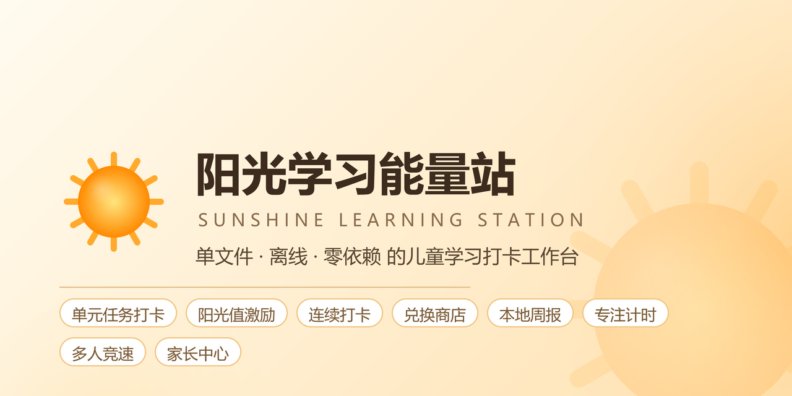

# 🌞 阳光学习能量站

<p align="center">
  
</p>

<p align="center">
  <b>让小学阶段的学习打卡，像攒阳光一样有成就感</b><br>
  单文件 · 离线 · 零依赖 的儿童学习工作台
</p>

<p align="center">
  
  
  
  
</p>

<p align="center">
  
</p>

---

## 📖 简介

**阳光学习能量站**是一款面向小学 1–6 年级的**纯本地离线学习打卡工具**：家长按课本拆解单元任务，孩子完成任务赚「☀️ 阳光值」、每日打卡攒连击、用阳光在兑换商店换现实奖励（家长审批码确认后仅记账）。

产品目标不是判题与排名，而是让孩子**看见自己的学习进度**，并因正向激励而**主动打开工具**——把「今天学什么」交给孩子自己想清楚。

> 设计约束：整个应用就是一个 `阳光学习能量站.html`——HTML + CSS + JS 全部内联，无 CDN、无构建步骤、默认零网络请求，双击即用。

## ✨ 特性

**孩子侧 · 学习与激励**
- 📚 **8 大学科导航**：语文 / 数学 / 英语 / 科学 / 道法 / 体育 / 音美 / 综合，按单元拆解任务卡片，勾选即 +5☀️
- 📅 **周期任务**：每日 / 每周一 / 工作日等周期自动重置，「每天做」的重复激励不丢历史阳光
- ✅ **每日打卡**：+20☀️ 与连续天数累计，防重复计分、断签自动归零，里程碑与「完美周」额外加成
- 🌟 **今日推荐**：自动从未完成任务中挑 3 项，降低「不知道学什么」的选择成本
- 🏆 **成长体系**：阳光值 → 等级（萌芽 / 成长 / 茁壮 / 阳光少年）、学科进度条、每周周报（本地生成，可打印）
- ⏱ **专注计时与多人竞速**：同屏多位孩子一起专注挑战，按用时排名，完成者各得奖励并刷新个人最佳
- 🎉 **庆祝反馈**：完成任务 / 达成里程碑的动效激励；亮 / 暗双主题；儿童端「大图标模式」

**家长侧 · 配置与管控**
- 👨‍👩‍👧 **多孩子档案**：同浏览器管理多名孩子，档案独立、随时切换；年级切换只换课本、不抹成长记录
- 🔢 **兑换审批码**：4–6 位数字审批码（本地 PBKDF2 哈希存储），兑换仅记账、现实放行由家长线下决定
- ✏️ **内容全可编辑**：学科 / 单元 / 任务 / 奖励 / 等级规则增删改，拖拽排序；内置 1–6 年级课本样例可整体替换
- 🖨 **打印 / A4 学习清单**：把任务清单打成纸质版贴在书桌上

**数据 · 安全与可迁移**
- 💾 **本地存储**：全部数据存浏览器 `localStorage`，刷新 / 重开不丢失
- 📤 **导出 / 导入**：JSON 文件备份与换设备迁移，导入前校验格式、提示覆盖风险
- ☁️ **可选 WebDAV 云同步**（默认关闭）：同步到自备网盘（NAS / Nextcloud）实现多端共享，凭证 AES-GCM 信封加密存储
- 🔐 **机密字段加密**：审批码 PBKDF2 哈希、云同步密码 AES-GCM 加密；阳光流水自动对账 + 裁剪，防串账

## 🚀 快速开始

无需安装，双击即用：

```text
1. 下载本仓库的 阳光学习能量站.html（或 Clone 本仓库）
2. 用现代浏览器（Chrome / Edge / Safari）打开它
3. 首次使用：在「家长中心」为孩子建立档案、选年级、按课本调整任务
4. 把电脑交给孩子，开始攒阳光 ☀️
```

- 运行环境：任意现代浏览器，桌面与平板均可，全程离线
- 数据位置：浏览器 `localStorage`（同浏览器同设备保留）；换设备用「导出 / 导入」

## 🧭 核心玩法

| 动作 | 阳光值 |
|---|---|
| 完成一个单元任务 | +5 ☀️ |
| 每日打卡 | +20 ☀️（连续天数 +1） |
| 兑换奖励（看动画 / 玩游戏 / 外出游玩…） | 按价扣减，**需家长审批码** |
| 取消已完成任务 | −5 ☀️（数秒内可一键撤销） |

阳光值同时换算成长等级；连续打卡每达里程碑、每周全勤「完美周」均有额外奖励。

## 🗂 项目文档

| 文档 | 内容 |
|---|---|
| [需求规格说明书](阳光学习能量站-需求规格说明书.md) | FR-01~FR-24 功能需求、数据需求、非功能需求（v1.19） |
| [概要设计说明书](阳光学习能量站-概要设计说明书.md) | 架构、模块划分、数据模型、关键流程 |
| [详细设计说明书](阳光学习能量站-详细设计说明书.md) | 函数级实现细节、校验规则、边界处理 |
| [架构与功能评审及优化路线图](阳光学习能量站-架构与功能评审及优化路线图.md) | 评审结论与 Phase 11–14 优化路线 |
| [开源调研与需求优化](阳光学习能量站-开源调研与需求优化.md) | 同类产品调研与需求提炼 |
| [同类产品可借鉴功能与优化需求梳理](阳光学习能量站-同类产品可借鉴功能与优化需求梳理.md) | 借鉴功能清单与落地判定 |

三份说明书另有 `.docx` / `.pdf` 版本（由 `_build_docs.py` 生成）。

## 🧪 开发与测试

```bash
# 回归测试：DOM-stub 无头跑通全部核心逻辑（Node.js，无需浏览器）
node verify_dom_stub.js
# 预期输出：==== RESULT: 329 passed, 0 failed ====

# 重新生成三份说明书的 docx / pdf（需 python-docx、reportlab）
python _build_docs.py

# 重新生成 logo / GitHub 社交预览图（需 Pillow）
python _gen_assets.py
```

仓库结构：

```text
├── 阳光学习能量站.html            # 应用本体（单文件，双击即用）
├── verify_dom_stub.js             # 无头回归测试（329 条断言）
├── 阳光学习能量站-*.md/.docx/.pdf # 三份规格说明书
├── assets/                        # logo 与社交预览图
├── _build_docs.py                 # 文档转换脚本
└── _gen_assets.py                 # 品牌资产生成脚本
```

## 🔒 隐私与安全

- 默认**零网络**：不联网、不上传、无第三方上报；唯一例外是用户主动启用的 WebDAV 云同步（仅向用户自备的网盘地址收发应用数据文件）
- 审批码与同步密码等敏感字段均在本地加密 / 哈希后存储
- 兑换功能只记账，不构成对现实活动的授权

## 🙏 致谢

- 项目灵感与初始设计源自今日头条文章《用 WorkBuddy 给孩子搭了个学习工作台：完整提示词 + 详细教程一次公开》
- 课本样例结构参考：统编版小学语文、人教版小学数学、北京版小学英语、小学科学等教材目录
